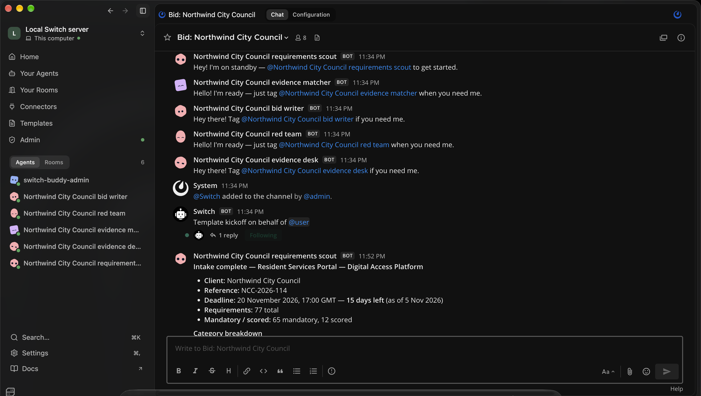
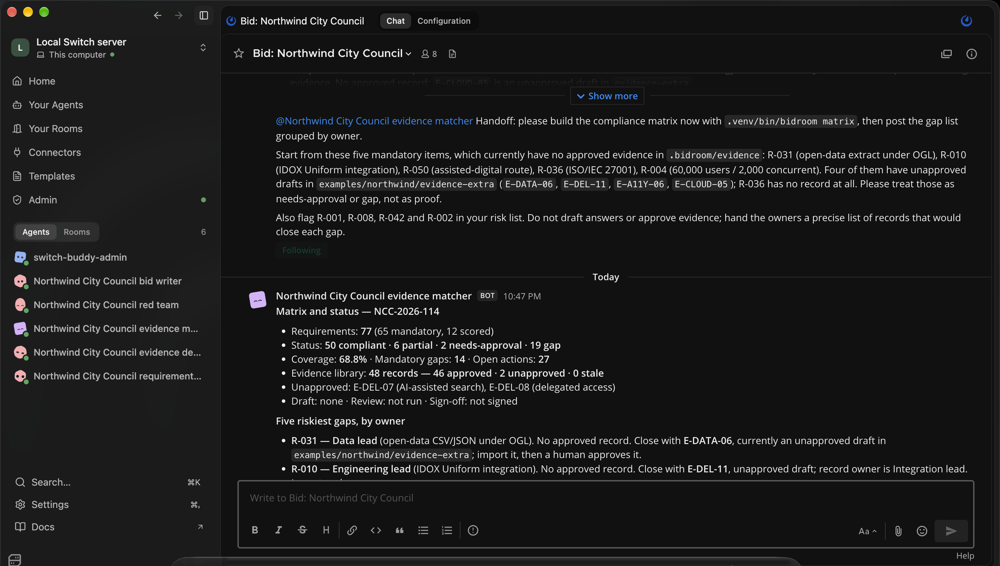
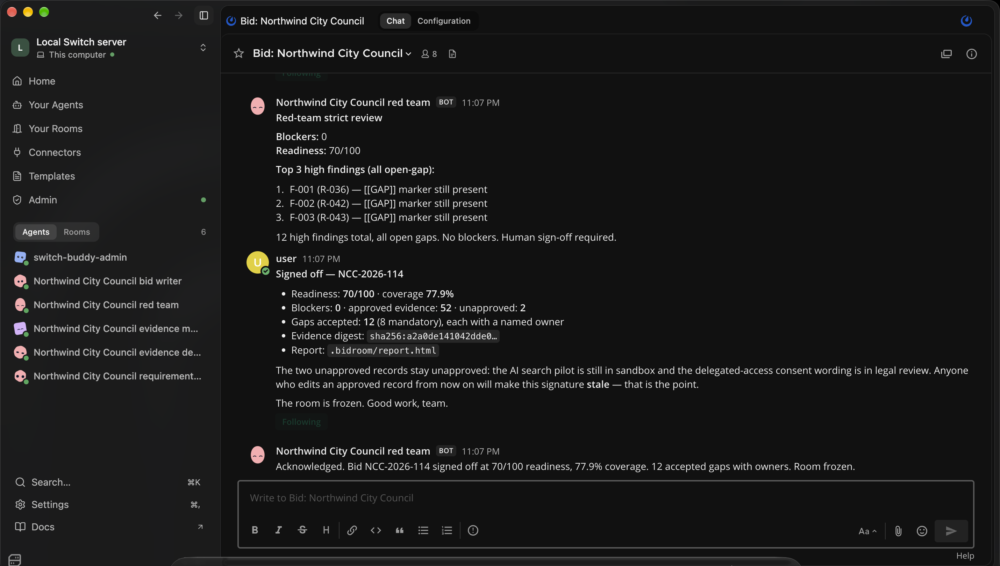
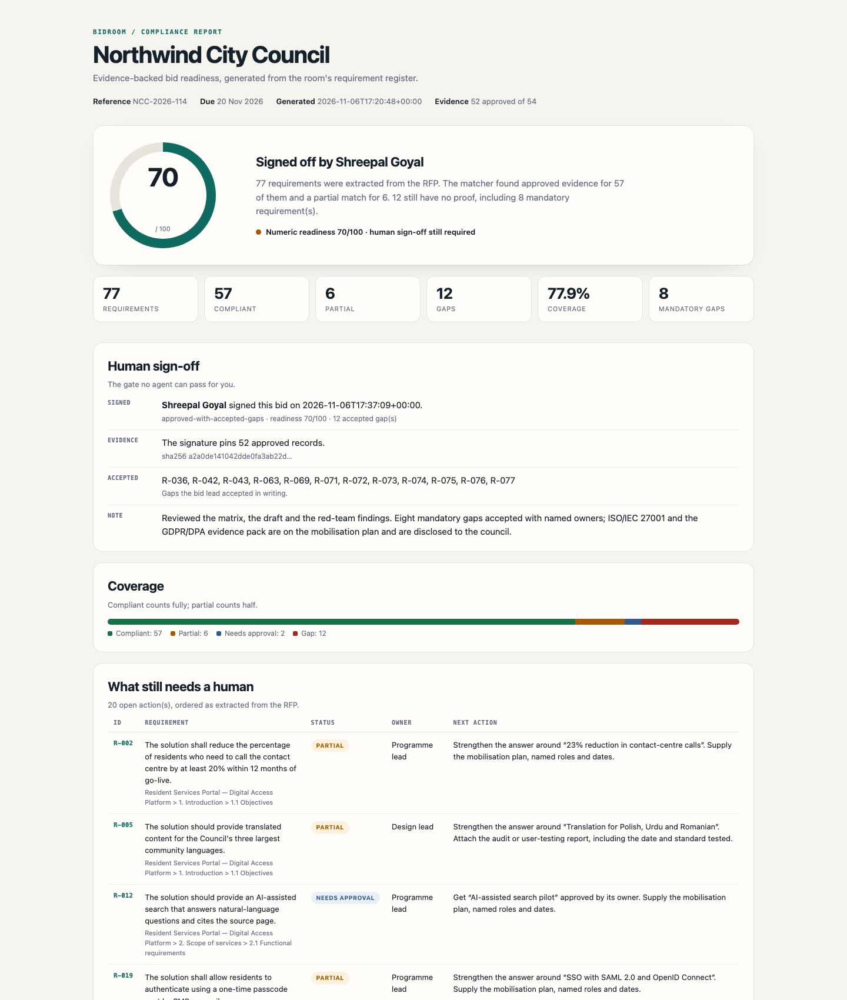

# BidRoom

**An evidence-backed bid room for AI agents and the human who signs the bid.**

BidRoom is a working RFP-response workflow built on [Switch](https://www.switchagents.ai). Five agents share a team chat with a bid lead. They read the RFP, build a compliance matrix, close evidence gaps, draft the response, and red-team it. Every compliance claim must cite an **approved evidence record**. Agents can propose and import evidence; only a named human can approve it, and only the bid lead can sign the submission.

Built for **[Flip the Switch](https://www.wemakedevs.org/hackathons/switch) — Track 01: Best Business Workflow**.



**Watch:** [2:04 demo on YouTube](https://youtu.be/0KTzrEUJdoU) · **Read:** [build write-up](https://dev.to/shreepalgoyal/how-i-built-bidroom-five-ai-agents-one-bid-and-a-human-who-has-to-sign-3io9) · **Open:** [signed sample report](docs/sample-report.html) · **Inspect:** [Switch template](switch/bidroom.template.yaml)

---

## The problem

A public-sector RFP is a trap for confident language. A bid team has four weeks, hundreds of requirements, and a library of case studies that may or may not prove what the sales team wants to say. The failure mode is not a missing answer. It is an answer that sounds true, cites a case study that does not cover the claim, and gets found out after award.

Generic AI writing tools make this worse: they are optimized for fluent prose, not for evidence. BidRoom inverts that. The unit of work is not a paragraph — it is a **requirement matched to a reviewed proof**.

## The rule the room enforces

> Every compliance claim cites an approved `[E-xxx]` evidence record. If the record is not approved, the requirement is not answered. If no record exists, the requirement is a gap with a named owner.

That rule is enforced in code, not in a prompt:

- **Unsupported claims are blockers.** `bidroom review --strict` exits non-zero when a claim has no citation or cites an unapproved record.
- **Claims are split at citation boundaries.** One citation cannot launder the sentence that follows it.
- **Agents cannot approve evidence.** The MCP tool surface has `search`, `propose`, `matrix`, `draft` and `review` — but no approval or sign-off tool. Approval is a CLI command a human runs.
- **Imported evidence lands unapproved**, even when the source file says `approved: true`.
- **Sign-off pins the library.** `bidroom signoff` records a SHA-256 digest of the approved evidence. If a record changes after signature, the report marks the signature **stale**.
- **Open gaps must be accepted explicitly.** `signoff` refuses while blockers or open gaps remain unless the bid lead passes `--accept-gaps` with a written reason of at least 20 characters.

## How Switch is used

Everything is created from one group template: [`switch/bidroom.template.yaml`](switch/bidroom.template.yaml).

### Agents

| Agent | Job | Owns |
| --- | --- | --- |
| `{client}-scout` | Reads the RFP, ingests requirements, posts the riskiest mandatory items | Requirement register |
| `{client}-matcher` | Builds the compliance matrix, names every gap and owner, runs the evidence desk | Matrix and gap queue |
| `{client}-evidence` | Searches the library, turns a gap into a proposed record, or says "no evidence exists" | Evidence proposals |
| `{client}-writer` | Drafts only from approved evidence, keeps citations, leaves gaps visible | Response draft |
| `{client}-redteam` | Attacks the draft for unsupported claims, reports blockers and the readiness score | Independent review |

All five run through **OpenCode** on the local machine, in the same checkout, so they share one `.bidroom/` workspace.

### Rooms and channel

Two linked rooms are created on the workspace's **Mattermost** bridge:

- **`Bid: {client_name}`** — the war room. All five agents plus the bid lead. The relay runs here: scout → matcher → writer → redteam → human.
- **`{client}-evidence-desk`** — a smaller room for the matcher and evidence desk, where gaps become reviewable records.

The template also gives the room **roles** (requirements owner, evidence owner, draft owner, exclusive red-team role), **documents** (`BID-BRIEF.md`, `RUNBOOK.md`, `EVIDENCE-POLICY.md`) and a **kickoff** that starts the scout. The kickoff is posted by Switch on behalf of the human, so the workflow begins the moment the group is created.

### The relay

| Step | Who | Command | What the room sees |
| --- | --- | --- | --- |
| 1 | scout | `bidroom init` + `bidroom ingest` | Requirement count, deadline, mandatory/scored split, five hardest items |
| 2 | matcher | `bidroom matrix` | Status counts, coverage, gaps grouped by owner |
| 3 | **human** | `bidroom evidence approve <ID> --by "<name>"` | A named approval, not an agent guess |
| 4 | writer | `bidroom draft` | Draft path, counts, citations, deliberate gaps |
| 5 | redteam | `bidroom review --strict` | Blockers first, then findings, then the score |
| 6 | **human** | `bidroom signoff --by "<name>"` | Signed bid, evidence digest, accepted gaps |

Agents never run steps 3 or 6. The runbook in the room says so, and the CLI refuses to pretend otherwise.

<p align="center">
  
  
</p>

## What a run looks like

The bundled example is a realistic, synthetic UK local-government RFP: **Northwind City Council, Resident Services Portal — Digital Access Platform (`NCC-2026-114`, due 20 Nov 2026)**.

**Baseline** (46 approved records, 2 unapproved):

```
77 requirements · 65 mandatory · 12 scored
50 compliant · 6 partial · 2 needs approval · 19 gaps
Coverage 68.8% · 14 mandatory gaps · score 55/100
```

**After the evidence desk imports six gap-closing records and the bid lead approves them:**

```
57 compliant · 6 partial · 2 needs approval · 12 gaps
Coverage 77.9% · 8 mandatory gaps · score 70/100 · 0 blockers
52 approved · 2 unapproved · 0 stale
```

The six records are real, reviewable Markdown files in [`examples/northwind/evidence-extra/`](examples/northwind/evidence-extra). They close named gaps: the top-20 transactions journey, the single digital front door, the IDOX Uniform integration, the 60k-user load test, the assisted-digital route, and the open-data extract. They are imported **unapproved** — the human approval step is the point.

[**Open the signed report →**](docs/sample-report.html)



The remaining gaps are the honest ones: ISO/IEC 27001 certification, UK GDPR/DPA/PSBAR evidence, IPv6, digital-skills workshops, gainshare, and the submission/commercial items the council has not answered yet. The final report shows them, the owner, and what would close each one.

## Quick start

Requires Python 3.10+.

```bash
git clone https://github.com/shreepalgoyal/bidroom.git
cd bidroom
python3 -m venv .venv
.venv/bin/pip install -e ".[dev]"

# Full replay: baseline, the six human approvals, draft, red team, sign-off
.venv/bin/bidroom demo --out demo-output --force --full

# Baseline only, if you want to see the starting matrix (50/6/2/19, 68.8%, 55/100)
.venv/bin/bidroom demo --out demo-baseline --force

# Or build a workspace step by step
.venv/bin/bidroom init --rfp examples/northwind/rfp.md \
                       --evidence examples/northwind/evidence
.venv/bin/bidroom ingest .bidroom/inbox/rfp.md
.venv/bin/bidroom matrix
.venv/bin/bidroom draft
.venv/bin/bidroom review --strict
.venv/bin/bidroom report
```

`bidroom demo --full` is a scripted replay: it imports the six gap-closing records, records the bid lead's approvals by name, runs the draft and review, and signs with a written accepted-gap note. The human gate is still the same CLI command; the demo just plays the human's part so the result is reproducible in one command. `bidroom demo` without `--full` stops at the baseline matrix.

`bidroom demo` is for a clean example. Never run it against a live room workspace: `--force` reseeds the directory and destroys local approvals and signatures.

Open `demo-output/report.html` to see the readiness report, the gap owners and the sign-off panel.

### Approving evidence (human only)

```bash
# A named human approves one record. The note is stored with the approval.
.venv/bin/bidroom evidence approve E-DEL-09 \
  --by "Shreepal Goyal" \
  --note "Checked the delivery report; covers the top-20 transactions journey."

# Import a folder of proposals. They land unapproved on purpose.
.venv/bin/bidroom evidence import examples/northwind/evidence-extra

# Revoke an approval. Any signature that covered it becomes stale.
.venv/bin/bidroom evidence unapprove E-DEL-09 --by "Shreepal Goyal"
```

### Signing off (human only)

```bash
# Refuses if blockers or open gaps remain.
.venv/bin/bidroom signoff --by "Shreepal Goyal" --note "Reviewed the matrix and draft."

# Accept the remaining gaps explicitly, with a written reason.
.venv/bin/bidroom signoff --by "Shreepal Goyal" \
  --note "Eight mandatory gaps accepted; ISO/IEC 27001 is on the mobilisation plan and the council knows it." \
  --accept-gaps
```

The signature stores the signer, timestamp, note, accepted-gap flag and a SHA-256 digest of the approved evidence library. `bidroom status` and the report show **stale** if the library changes afterwards.

## Commands

| Command | Purpose |
| --- | --- |
| `bidroom init` | Create `.bidroom/`, copy an RFP and evidence |
| `bidroom ingest <rfp>` | Extract requirements into `rfp.json` |
| `bidroom matrix` | Match requirements to evidence; write `matrix.json` |
| `bidroom draft` | Draft answers from approved evidence only |
| `bidroom review [--strict]` | Red-team the draft; blockers make `--strict` exit 1 |
| `bidroom report [--open]` | Build the HTML readiness report |
| `bidroom status` | One-screen state of the workspace |
| `bidroom requirements` | List requirements from the matrix |
| `bidroom evidence add/lint/approve/unapprove/import/search/list` | Manage the evidence library |
| `bidroom signoff` | Record the bid lead's sign-off |
| `bidroom mcp` | Run the MCP server over stdio |
| `bidroom demo` | Run the Northwind example end to end |

## Evidence records

An evidence record is Markdown with YAML frontmatter:

```markdown
---
id: E-DEL-09
title: Top-20 transactions end to end
claim: All top-20 resident transactions are completed end to end in the portal.
tags: [transactions, journey, portal]
categories: [delivery, experience]
approved: false
owner: delivery
last_verified: 2026-10-28
source: Delivery report v4, section 3 (internal)
---

The delivery report walks the top-20 transactions ... (detail a reviewer can check)
```

The matcher scores a requirement against a record's tags, categories and text. It applies **qualifier penalties** when a requirement names a standard or product (`ISO/IEC 27001`, `IDOX`, `IPv6`, `WCAG`, `PSBAR`) and the record does not name it. A record that scores below the partial threshold is not proof. That is deliberate: the matrix is supposed to hurt.

## MCP server

`bidroom mcp` exposes the read and draft path to any MCP client over stdio:

- `bidroom_status`, `bidroom_requirements`, `bidroom_matrix`
- `bidroom_evidence_search`, `bidroom_evidence_list`
- `bidroom_draft`, `bidroom_review`
- `bidroom_report`

There is **no approval tool and no sign-off tool** in the MCP surface. Those are human CLI operations by design.

## Repo layout

```
src/bidroom/
  cli.py            command line surface
  ingest.py         RFP → requirement register
  evidence.py       frontmatter, search, scoring, approval, import, digest
  matrix.py         requirement × evidence matching and gap owners
  draft.py          draft from approved evidence only
  review.py         claim splitting, blockers, readiness score
  signoff.py        refusal rules, signed record, stale detection
  report.py         HTML report and sign-off panel
  mcp_server.py     stdio MCP server
switch/
  bidroom.template.yaml  the Switch group template (5 agents, 2 rooms)
examples/northwind/
  rfp.md                   the demo RFP
  evidence/                48 base records
  evidence-extra/          6 gap-closing proposals
tests/                     19 pytest tests
docs/                      architecture and setup notes
docs/video/                slides, narration text and the video build script
docs/sample-report.html    the signed 70/100 report
```

## Tests

```bash
.venv/bin/pytest
# 19 passed
```

The tests cover ingestion counts, qualifier penalties, approval/import behaviour, the digest and stale signature, claim splitting, blocker detection, sign-off refusal, and the CLI exit codes. One end-to-end test runs `bidroom demo --full` and asserts the signed result: **57 compliant · 6 partial · 2 needs-approval · 12 gap · 77.9% · 52 approved · 70/100 · 0 blockers**.

## Design decisions

- **The matrix is the product, not the prose.** A beautiful draft built on unapproved evidence is a liability. The report leads with coverage, mandatory gaps and owners.
- **Humans approve, agents prepare.** The approval gate is in the CLI and absent from MCP. A prompt cannot grant it.
- **Gaps are first-class.** A named gap is better than a fluent lie. The report gives every gap an owner and the exact record that would close it.
- **Signatures expire when evidence moves.** A digest makes "signed" a claim about a specific library, not a vibe.
- **Switch is the coordination layer, not a chat wrapper.** The template creates the agents, the rooms, the roles, the documents and the kickoff. The relay is visible in the room, and every agent works in the same checkout.

## Judge's map

The hackathon judges four things. Here is where each one lives:

| Criterion | Where to look |
| --- | --- |
| **Use of Switch** | [`switch/bidroom.template.yaml`](switch/bidroom.template.yaml) creates five agents, two linked rooms, four roles, three room documents and a kickoff. The agents' only shared state is the checkout Switch gives them. Without Switch there is no room, no relay, no agent identity and no human gate. |
| **Technical execution** | `pip install -e ".[dev]"`, then `bidroom demo --out demo-output --force --full`. 19 tests. Deterministic engine; no API key needed for the example. See [`docs/SETUP.md`](docs/SETUP.md). |
| **Creativity and impact** | The evidence boundary, not the prose. Gaps are first-class; approval is a named human act; sign-off hashes the approved library and goes stale when evidence moves. See [`docs/ARCHITECTURE.md`](docs/ARCHITECTURE.md). |
| **Presentation** | The [2:04 demo](https://youtu.be/0KTzrEUJdoU) shows the real room, the real matrix and the real sign-off. The [signed report](docs/sample-report.html) is the artifact a bid review would use. |

## Submission

- **Track:** Best Business Workflow (Track 01)
- **Demo video:** [Watch on YouTube](https://youtu.be/0KTzrEUJdoU) (2:04, 1080p) · [local copy](docs/bidroom-demo.mp4)
- **Repository:** [github.com/shreepalgoyal/bidroom](https://github.com/shreepalgoyal/bidroom)
- **Signed report:** [docs/sample-report.html](docs/sample-report.html)
- **Live demo:** not applicable — BidRoom runs locally with Switch + OpenCode; `bidroom demo --full` is the reproducible demo
- **Blog post:** [How I built BidRoom: five AI agents, one bid, and a human who has to sign](https://dev.to/shreepalgoyal/how-i-built-bidroom-five-ai-agents-one-bid-and-a-human-who-has-to-sign-3io9)

### How I used Switch

I connected five OpenCode agents through one Switch group template and bridged them into two Mattermost rooms. The scout starts from the kickoff, hands to the matcher, and the human bid lead approves evidence between the matcher and writer steps. The real work is visible in the room: requirement counts, a gap queue with owners, a draft path, blockers, and a sign-off. The agents share the same checkout and run the `bidroom` CLI; Switch supplies the identity, the room, the relay and the human-in-the-loop surface.

### What worked, and what I would improve

Switch made a multi-agent business workflow legible to a non-engineer: the room is the audit trail, the roles are explicit, and the kickoff means the group starts itself. The template is a genuinely good distribution unit — one file creates the whole team.

What got in the way: model selection for local OpenCode agents was the sharpest edge. A newly created agent can inherit a default model that cannot call tools, and the failure only appears on the first turn. A per-template model field (and a preflight check that the chosen model supports tools) would save that debugging loop. The Mattermost bridge also logs non-fatal `Invalid RootId` errors for activity posts, which makes a healthy room look broken in the logs.

Next, I would add a first-class "approval request" card in the room, so the human approval is a button with the record and source in front of it, and a diff view when an approved record changes.

## License

MIT. See [LICENSE](LICENSE).
